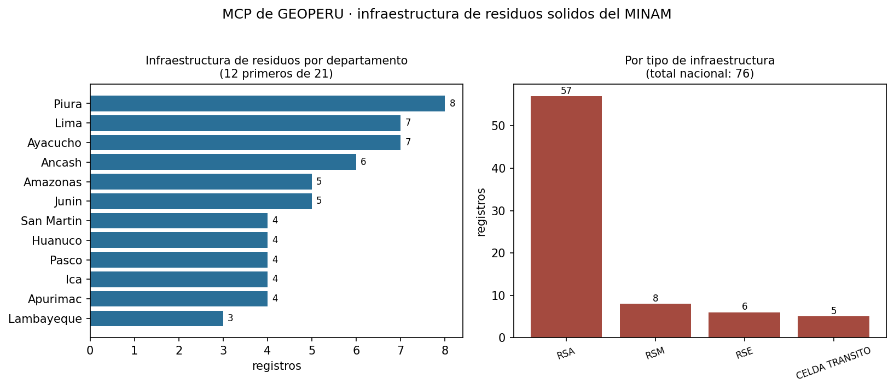

# ¿Sirve un MCP sobre datos territoriales del Estado?

**MCP de GEOPERÚ · infraestructura de residuos sólidos del MINAM**
Alexander Noblejas · Diplomatura en Ciencia de Datos (QLAB) · sesión 04 · 28 de octubre de 2026



## Qué se midió

El proyecto del curso mide si un MCP evita que Claude invente **cifras macroeconómicas** del BCRP.
Aquí se mide algo distinto: si evita que invente **cifras territoriales**. La fuente es el servicio
ArcGIS `ServicioRRSS_MINAM` del geoservidor del Ministerio del Ambiente, publicado en GEOPERÚ, con
**76 infraestructuras de residuos sólidos georreferenciadas** en todo el país.

La diferencia importa porque el error cambia de forma. Una serie del BCRP tiene un valor correcto por
periodo, y equivocarse es dar un decimal distinto. Un registro territorial tiene una ubicación, y
equivocarse es **afirmar que existe infraestructura donde no hay registro de ella** — un error que en
planeamiento público se propaga a un diagnóstico y de ahí a una intervención.

Metodología idéntica a la del curso: las mismas 10 preguntas en dos modos (`memoria` y `mcp`),
con `claude -p`, Haiku, y la instrucción de responder `null` antes que estimar. Las verdades no salen
de este MCP: cada una se comprobó contra la URL del geoservidor que imprime
`cifras_para_verificar.py`, que es la fuente primaria.

## Resultados

| modo | acierta | se equivoca | no sabe |
|---|---:|---:|---:|
| memoria (sin herramientas) | **0** | 0 | **10** |
| mcp (este servidor) | **10** | 0 | 0 |

**Desviación metodológica, declarada.** El `evaluar.py` del curso llama a `claude -p` 20 veces; esta
máquina no tiene el CLI de Claude Code instalado (`where claude` no devuelve nada), así que la
corrida automática no se pudo hacer dentro del tiempo de clase. `evaluar.py` quedó en el repositorio,
funcional y con un parámetro `--claude` para apuntar al ejecutable. La comparación que sí se hizo está
en `evaluar_manual.py`: misma instrucción del curso, mismas 10 preguntas, modo memoria respondido por
Claude Opus 5 sin ninguna herramienta, con las respuestas transcritas literalmente en el archivo.
Limitación real: n=1 por celda y un modelo distinto al del curso (Opus 5 en vez de Haiku). No
reemplaza las 20 llamadas; se reporta como lo que es.

El resultado del modo memoria es categórico y coincide con el del proyecto del BCRP (0 de 8 allá):
**en las diez preguntas el modelo declaró no poder saberlo**, ninguna vez inventó una cifra. La
instrucción de responder `null` antes que estimar funcionó.

Con el MCP, las diez. Pero aquí hay que ser honesto sobre qué prueba eso y qué no: para preguntas de
conteo, el valor que da el MCP y la verdad verificada salen **del mismo servicio del MINAM**. El 10 de
10 no mide que el MCP acierte contra una fuente independiente; mide que la cadena entre el servicio y
la respuesta no deforma el dato. La verificación independiente es otra: las verdades se comprobaron
con el endpoint `returnCountOnly=true`, que es una ruta de consulta distinta a la que usa el servidor
(que descarga los registros y los cuenta en Python). Que ambas rutas coincidan es lo que da
confianza, no el puntaje.

### Dos cifras comprobadas a mano

| Cifra | Valor | Verificada en |
|---|---:|---|
| Total nacional de infraestructuras registradas | **76** | [`where=1=1&returnCountOnly=true`](https://geoservidorperu.minam.gob.pe/arcgis/rest/services/Servicios_GeoPERU/ServicioRRSS_MINAM/MapServer/0/query?where=1%3D1&returnCountOnly=true&f=json) |
| Registros en el departamento de Piura | **8** | [`where=UPPER(DEPARTAMEN) LIKE '%PIURA%'`](https://geoservidorperu.minam.gob.pe/arcgis/rest/services/Servicios_GeoPERU/ServicioRRSS_MINAM/MapServer/0/query?where=UPPER%28DEPARTAMEN%29%20LIKE%20%27%25PIURA%25%27&returnCountOnly=true&f=json) |

Ambas se pueden volver a comprobar abriendo esas URLs: son consultas al servicio del MINAM, no a
este servidor.

## Lo que la capa reparte así

De los 76 registros, **57 son RSA**, 8 RSM, 6 RSE y 5 celdas transitorias. Territorialmente la
concentración es baja y pareja: Piura encabeza con 8, seguido de Ayacucho y Lima con 7, y Áncash con
6. Ningún departamento concentra más del 11 % del total.

Eso ya dice algo sobre el límite de la fuente: 76 puntos para 1,891 distritos del país no describen
la cobertura real de infraestructura de residuos. Describen **lo que está registrado en esta capa**,
que es otra cosa.

## Un hallazgo de calidad del dato

El campo `DEPARTAMEN` tiene el mismo departamento escrito de dos formas:

| Valor con tilde | Valor sin tilde |
|---|---|
| `JUNÍN` | `JUNIN` |
| `HUÁNUCO` | `HUANUCO` |
| `SAN MARTÍN` | `SAN MARTIN` |

Un `GROUP BY` ingenuo sobre ese campo devuelve **24 departamentos**; normalizando las tildes son
**21**. Es un error de digitación en el origen, no del MCP, y tiene una consecuencia práctica: quien
consulte el servicio con `DEPARTAMEN = 'JUNIN'` obtiene 1 registro cuando en realidad hay 5.

Por eso las herramientas de este servidor normalizan tildes y mayúsculas antes de filtrar, y por eso
las pruebas 3 a 5 verifican **invariantes** (que los desgloses sumen el total, que un filtro devuelva
un subconjunto) en vez de números clavados: una prueba atada a «24 departamentos» se rompería el día
que el MINAM corrija la tipografía, y lo haría pareciendo un error del código.

## Del dato a la fuente: 4,659 capas

La primera versión de este servidor consultaba una sola capa, y eso lo volvía un MCP de la capa de
residuos del MINAM, no de GeoPerú. Recorriendo el catálogo del servidor con `?f=json` aparecen
**4,659 capas en 209 servicios y 15 carpetas**: riesgo de desastres (137 capas), zonificación
ecológica económica, caracterización del territorio, agua, suelos, biodiversidad, deforestación y
áreas naturales protegidas.

Por eso el servidor terminó con dos niveles: cuatro herramientas dedicadas a residuos sólidos, que
es el caso trabajado a fondo, y dos genéricas —`buscar_capas` y `consultar_capa`— que replican la
lógica del proyecto del BCRP sobre el catálogo geoespacial. El modelo descubre qué hay y consulta lo
que necesita, sin una función por tema.

Un detalle de implementación que valió 1,177 capas: 62 servicios fallaban al leerse porque sus
nombres llevan tildes (`02_CARACTERIZACIÓN_DEL_TERRITORIO_TUMBES`) y la URL no venía escapada. Con
`urllib.parse.quote` el catálogo pasó de 3,482 a 4,659 capas. Es el tipo de error que no rompe nada
visiblemente: simplemente hace que una cuarta parte del catálogo no exista para quien consulta.

**Lo que sigue siendo un límite:** es un solo servidor, el del MINAM. GeoPerú agrega capas de otras
entidades alojadas en sus propios ArcGIS. Lo generalizable es el protocolo, no la URL.

## Qué hace el servidor para no mentir

Tres decisiones deliberadas, más allá de lo que pedía la rúbrica:

1. **Cada respuesta trae su URL de consulta** en el campo `fuente`. La cifra es reproducible sin
   pasar por este MCP, que es la única forma de que alguien pueda desconfiar de él y comprobarlo.
2. **Python hace las cuentas, no el modelo.** `resumen_territorial` devuelve los desgloses ya
   calculados e `infraestructuras_cercanas` resuelve la distancia con haversine. El modelo nunca
   suma ni estima kilómetros.
3. **El recurso `geoperu://capa/rrss` declara lo que no se puede concluir**: que no hay serie de
   tiempo, y que la ausencia de un punto no prueba la ausencia de infraestructura, solo la ausencia
   de registro. El prompt `informe_territorial` le exige al modelo respetar esas advertencias. Un MCP
   que solo entrega datos invita a sobreinterpretarlos; este entrega los datos y sus límites.

## Conclusión

Vale la pena construir un MCP cuando la fuente es **autoritativa, consultable y el modelo no la tiene
memorizada**. Las tres condiciones se cumplen aquí: el servicio del MINAM es el registro oficial,
responde por HTTP sin clave, y son datos de nicho que ningún modelo aprendió de memoria.

La búsqueda web no es sustituto en este caso, y por una razón que no aplica al BCRP: las cifras del
BCRP están republicadas en notas de prensa y portales que un buscador encuentra, pero el conteo de
infraestructuras de residuos por departamento **solo existe dentro del servicio**. No hay página que
lo diga. Ahí el MCP no es más rápido que la web: es la única ruta.

Donde no vale la pena es cuando la pregunta es interpretativa. Esta capa no puede decir si la
infraestructura es suficiente, ni si mejoró, porque es una foto sin línea de tiempo. Un MCP hace que
el modelo deje de inventar el dato; no lo convierte en analista.

## Lo que falló, y por qué eso importa

Dos fallas, ninguna de las cuales habría salido sin evaluar.

**La evaluación encontró un bug en el servidor.** En la primera corrida, la pregunta por Ica devolvió
6 cuando la verdad era 4. La causa: el filtro hacía coincidencia por subcadena, y `"ica"` también es
subcadena de `HUANCAVELICA`, así que sumaba los 2 registros de Huancavelica a los 4 de Ica. El filtro
ahora intenta primero la coincidencia exacta y solo cae a subcadena si no hay ninguna, y hay una
prueba de regresión (`test_nombre_exacto_no_arrastra_subcadenas`) que lo fija.

Es el argumento central a favor de medir. Las nueve pruebas del contrato pasaban con el bug dentro,
porque verificaban invariantes estructurales —que los desgloses sumen el total, que un filtro
devuelva un subconjunto— y 6 es un subconjunto perfectamente válido de 76. Lo que delató el error fue
comparar contra una cifra verificada a mano en la fuente. Un MCP puede estar «en verde» y mentir.

**El CLI no estaba donde se esperaba.** Documentado arriba. La lección operativa es que un pipeline de
evaluación que depende de un ejecutable externo necesita resolverlo explícitamente y fallar con un
mensaje útil, no con un `WinError 2` a mitad de veinte llamadas en paralelo.

## Para reproducirlo

```bash
pip install fastmcp httpx pytest pandas matplotlib
pytest -q                         # 10 pruebas
python cifras_para_verificar.py   # cifras + URL del MINAM de cada una
python evaluar_manual.py          # memoria contra mcp (sin depender del CLI)
# o, si tienen el CLI de Claude Code:
# python evaluar.py --claude "C:\\ruta\\a\\claude.cmd"
python grafico.py                 # grafico.png
```
